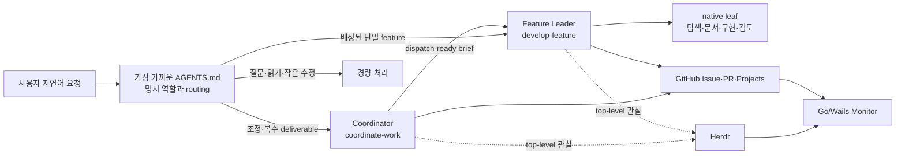

# ThreadDock Agent workflow 아키텍처와 개선 검토

## 문서 목적과 범위

이 문서는 운영자와 이후 개발·Agent가 현재 workflow의 책임, 실행 경계, 근거 수준을 한곳에서 이해하도록 한다.
제품 코드나 실행 엔진의 설계가 아니라, GitHub·Herdr·native subagent를 잇는 Agent 지침 아키텍처를 설명한다.

현재 구조의 목표는 다음과 같다.

- 사용자는 자연어로 일을 요청하고, 필요한 경우에만 Coordinator와 Feature Leader lifecycle로 진입한다.
- GitHub는 업무 원본, Herdr는 top-level 실행 lifecycle, native subagent는 feature 내부 실행 수단으로 사용한다.
- 계획·구현·검토 근거를 분리하되 같은 사실을 여러 상태 저장소에 복제하지 않는다.
- 작은 작업은 작게 처리하고, 중요한 위험에만 독립 검토와 추가 근거를 요구한다.

이 문서는 제거된 Go 실행 엔진, Contract v2, Invocation/Artifact, Task Gate/Publisher를 복원하거나 대체하지 않는다.
또한 아래 개선안은 검토 결과이지 구현 승인이나 설정 변경 지시가 아니다.

## 전체 구조

Go 백엔드는 GitHub와 Herdr를 조회·결합하고 기존 React 화면은 이를 관찰한다.
Monitor는 조회, 링크 열기, handoff 복사, 세션 복귀 안내를 제공하지만 새 작업을 예약·승인·실행하는 엔진이 아니다.
Vite/Node는 화면 개발·빌드 도구이며 별도 조회 서버나 HTTP bridge가 제품 경로에 들어가지 않는다.

## 지침과 설치 계층

이 구조는 harness의 상위 지침과 실제 권한을 전제로 한다.
전역 natural-entry는 명시적으로 배정된 역할과 더 가까운 프로젝트 지침을 존중하는 fallback router이며, 별도의 절대 우선순위를 만들지 않는다.
tracked 설치 원본은 다음처럼 역할이 나뉜다.

| 계층 | 원본 | 책임 |
|---|---|---|
| 전역 진입 | `project-template/global/AGENTS.md` | 자연어 요청을 가볍게 분류하고 관련 Skill로 연결 |
| 프로젝트 정책 | 저장소의 `AGENTS.md` | 제품 범위, 역할 경계, 검증·게시 정책 |
| 공용 Skill | `project-template/.agents/skills/` | 단계별 행동 계약과 근거 기준 |
| Codex 역할 | `project-template/.codex/agents/` | 조정/기능리더를 포함한 native 위임용 역할 정의와 예시 모델 metadata |
| OpenCode 역할 | `project-template/.opencode/agents/` | primary/subagent mode와 도구 permission |

Skill을 읽거나 역할 파일을 설치하는 일은 root의 runtime 모델, provider, effort, sandbox, 승인 또는 권한을 자동 선택하지 않는다.
설치 시 대상 환경의 기존 설정을 보존하며, 지원되지 않는 모델을 임의 대체하지 않는다.
OpenCode의 `edit: deny` 같은 leaf 설정과 reviewer의 읽기 전용 책임은 방어층이지만 OS 수준 격리를 증명하지 않는다.
이미 시작된 session이 새 파일을 다시 읽었다는 보장도 없으므로, 저장소·전역 설치 상태와 현재 loaded-session 상태를 구분한다.

## 역할과 소유권

상주하는 top-level 역할은 Coordinator와 Feature Leader뿐이다.

- Coordinator는 목표, 제품 범위, 우선순위, 의존성, 공유 제약과 권한 범위를 정리한다.
- Coordinator는 구현 전체계획을 대신 쓰지 않고 dispatch-ready brief를 단일 Feature Leader에게 넘긴다.
- Feature Leader는 한 feature의 계획, task 분해, 통합, 검증, 독립 리뷰, PR 준비를 단독 소유한다.
- `td_explorer`, `td_docs_editor`, `td_implementer`, `td_reviewer`는 필요한 때만 쓰는 transient native leaf다.
- leaf는 자기 packet을 완료해 부모에게 결과를 돌려주며 coordination을 다시 시작하거나 다른 일을 재배정하지 않는다.
- 사람은 제품 목적·범위·위임하지 않은 중요 선택과 최종 main 병합을 소유한다.

내부 leaf는 Herdr top-level session이나 `sessions.json` binding으로 복제하지 않는다.
native subagent 기능이 있다는 사실은 특정 단계가 실제 실행됐다는 근거가 아니다.
반대로 Herdr의 `idle`·`done`도 GitHub 업무 완료를 뜻하지 않는다.

## 요청별 lifecycle

일반 질문과 읽기 전용 상태 요청은 파일 변경, session 생성, 리뷰 ceremony 없이 직접 답한다.
명백한 오타 같은 작은 수정은 좁은 범위와 해당 검증만 사용하며 중요한 계획 검토를 강제하지 않는다.
계획-only 요청은 계획 범위에 머물며 구현, Feature Leader session 생성, GitHub 쓰기로 권한을 넓히지 않는다.

조정 요청에서는 Coordinator가 먼저 관련 Issue·문서·코드를 확인하고 모르는 것을 분류한다.

- 사용자 흐름·범위·화면 의미·완료 조건·외부 효과가 달라지는 미결 제품 선택만 사용자에게 묻는다.
- 저장소에서 확인할 사실은 조사하고, 구조·파일·알고리즘·테스트 내부는 Feature Leader의 구현 선택으로 둔다.
- 되돌릴 수 있는 무해한 가정은 밝히고 진행한다.
- 이미 합의한 계획은 reference/revision과 유효한 검토 근거를 넘겨 재사용한다.

Feature Leader의 현재 기준 흐름은 다음과 같다.

1. brief, 원 요청·acceptance, 권한, 의존성, 기존 계획의 실행가능성을 확인한다.
2. 여러 실질적 설계안이 있는 큰 변경만 `brainstorm-design`으로 방향을 좁힌다.
3. 중요한 새 계획이나 실질적으로 바뀐 위험은 고정 revision으로 독립 반대 검토를 한 번 받는다.
4. owner가 finding을 근거로 좁게 반영하거나 기각 이유를 남긴다.
5. 중요한 이견이 남은 경우에만 다른 중립 reviewer가 그 쟁점 하나를 판정한다.
6. 제품 코드·테스트 편집은 bounded implementation child에 맡기고 affected focused verification을 수행한다.
7. exact candidate SHA/diff와 실제 acceptance 근거를 fresh implementation-independent reviewer가 검토한다.
8. PR이 있으면 PR, 없으면 Issue/요청 기록 한곳에 상세 근거를 남기고 다른 기록은 요약·참조한다.

작은 작업과 변경 없는 합의에는 위 전체 cycle을 반복하지 않는다.

## UI 경로

중요한 문구·화면·flow 변경은 신규 사용자, 반복 작업자, 편집/접근성의 세 독립 관점에서 후보를 만든다.
작성자 정보를 가린 A/B/C 평가로 한 방향을 선택하고, 한 editor가 의미와 상태를 보존한 일관된 결과로 정리한다.
이는 모든 UI 변경에 세 명을 강제하는 규칙이 아니며, 오타는 직접 고친다.

모든 UI 변경은 렌더링 screenshot을 이미지 입력 가능한 Agent가 실제로 열어 관찰하고 관련 interaction을 실행해야 한다.
DOM snapshot, capture 성공, 파일 경로, build 성공만으로 visual acceptance를 통과시키지 않는다.
React fixture 증거와 packaged Wails·live GitHub/Herdr 증거도 별도로 표시한다.
현재 선택 모델이 이미지를 지원하지 않으면 그 검증을 미확인으로 남긴다.
prompt만으로 지원되지 않는 vision 능력을 만들 수 없으며, 지원 모델 경로 선택은 사용자 결정 없이 자동 전환하지 않는다.

## 업무·실행·근거 원본

| 정보 | 원본 | 해석 경계 |
|---|---|---|
| 업무 상태·우선순위·결정 | GitHub Issue·PR·Projects | durable work truth |
| top-level 실행 위치·관찰 상태 | Herdr | 업무 완료 판정이 아님 |
| GitHub↔Herdr 위치 연결 | `~/.threaddock/sessions.json` | lock 아래 갱신하는 local locator일 뿐 |
| 상세 검증 | 현재 PR, 없으면 Issue/요청 기록 | candidate revision과 환경에만 유효 |
| Monitor 화면 | Go/Wails 조회 결과 | 원본을 결합한 관찰, 새 상태 원본이 아님 |

외부 쓰기와 Herdr 제어는 기존 승인 범위 안에서만 한다.
자동 merge, 권한 확대, 모델 교체, 승인 우회는 lifecycle 완료 수단이 아니다.
locator overwrite/schema/GHES 문제는 별도 backlog이며 이번 workflow 준수 개선의 중심 문제로 섞지 않는다.

## 2026-10-17 확인한 배포·실행 상태

상태는 “파일이 있음”과 “현재 session에서 행동함”을 분리해 읽어야 한다.

| 범위 | 관찰된 상태 |
|---|---|
| 원격 `origin/main` | `b04cf2a`: 이전 Coordinator plan-first 기준이 게시된 상태 |
| 이 로컬 문서 기준 | `9622d0e`: Feature Leader 계획 소유, material ambiguity, 조건부 중립 판정, simple architecture, natural router 포함 |
| 현재 WSL 전역 설치 | tracked natural-entry와 Skill/role의 현행판을 설치했다는 HANDOFF 기록이 있음 |
| 이미 열린 session | 시작 시 읽은 지침·역할을 계속 쓸 수 있어 새 파일 적용 여부를 별도 확인해야 함 |

따라서 로컬 지침을 설명하면서 원격 main에도 이미 배포됐다고 말하거나, 설치 성공을 실제 lifecycle 준수 성공으로 확대하면 안 된다.
향후 게시 후에는 commit/PR을 근거로 이 표를 갱신한다.

## 2026-10-16 행동 시험이 보여준 간극

[Codex 보고서](../superpowers/reviews/2026-10-16-codex-model-behavior.md)와
[OpenCode 보고서](../superpowers/reviews/2026-10-16-opencode-natural-entry-behavior.md)는 각각 한 번씩의 격리 fixture 관찰이다.
성공률, 일반적 모델 우열, 인과적 모델 결함의 증거가 아니다.

- Codex의 migration 계획은 `develop-feature`와 generic `writing-plans`를 읽었지만 `grill-plan`이나 독립 reviewer 없이 초안으로 끝났다.
- OpenCode도 `develop-feature`에는 진입했지만 중요한 계획 검토는 실행하지 않았다.
- OpenCode의 우선순위 답변은 범위와 결과는 맞았으나 `coordinate-work` 본문을 읽은 흔적은 없었다.
- 명시적으로 reviewer 사용을 요청했을 때 두 harness 모두 실제 native child 호출과 결과 회수를 보였다.
- Codex는 parent-child edge와 `gpt-6-astra`/`medium` runtime metadata를 기록했고, 같은 PNG의 네 항목을 읽었다.
- OpenCode의 현재 `opencode/big-pickle` 경로는 image capability metadata가 false였고 실제로도 이미지를 볼 수 없다고 답했다.

기존 explicit-skill 시험의 PASS는 이름을 말하지 않은 자연어 요청에서 Skill이 자동 선택된다는 증거가 아니다.
또한 native 위임 기능의 PASS는 요구된 독립 검토 단계가 매번 수행된다는 증거가 아니다.
두 migration 출력은 모두 미결 사항을 남긴 초안이므로 거짓 `implementation-ready`를 주장했다는 증거도 아니다.
generic planning Skill 사용이 검토 누락의 원인이라고 입증되지 않았고, 이미 정리된 reviewer mode 경계를 현재 결함으로 다시 세지 않는다.
현재 문서와 Skill은 instruction-level expectation이며, 단계 실행을 기계적으로 강제하는 scheduler나 state machine은 없다.

## 최소 개선 대안과 권고

| 대안 | 내용 | 장점 | 비용·위험 |
|---|---|---|---|
| A. Feature Leader 계약 강화 | 단계와 출력에 `draft/review pending/reviewed/implementation-ready`, 고정 plan revision, 독립 검토 receipt, 조건부 adjudication을 명시 | 현재 구조만 고쳐 핵심 누락을 직접 다룸 | 지침만으로 100% 기계 강제되지는 않음 |
| B. 최소 evidence record | 기존 응답에 plan revision, native reviewer 결과 참조·verdict, 남은 중요 항목을 한 줄로 남김 | 반복적인 근거 수집과 누락 판별이 쉬움 | 새 DB·파일이나 가짜 reviewer로 확장하지 않게 제한 필요 |
| C. 선택적 harness hook | 충분한 입력·명확한 단계에서도 누락이 반복될 때 Stop/PreTool 경고만 추가 | 명백한 누락을 일찍 노출 가능 | 신뢰·설치 drift·오탐 비용, Stop continuation loop 위험 |

권고는 A를 먼저 적용하고 이름 없는 targeted fixture로 다시 확인하는 것이다.
generic planning Skill은 작성 helper일 수 있지만 별도 lifecycle owner는 아니다.
적용되는 사용자 요청·프로젝트 지침을 존중하면서 선택된 ThreadDock 단계와 결과 계약을 대체하지 못하게 한다.
B는 A와 함께 기존 결과 형식의 최소 필드로 시작하고, 독립 검토를 흉내 내거나 새 실행 엔진·SQLite schema가 되어서는 안 된다.
C는 A·B 뒤에도 충분한 입력의 명확한 단계에서 검토 누락이 실제로 반복될 때만 검토한다.
독립 검토 의견도 이 순서와 “reviewed와 ready의 분리”를 지지했으며, 이 문서는 이를 제안으로 반영했을 뿐 설치하지 않았다.

A의 제안 계약에서는 자료가 충분한 일반적인 중요 계획을 owner가 고정하고 한 번 독립 검토한 뒤 finding을 해결한다.
계획-only는 구현 금지 범위이지 필요한 계획 검토의 자동 생략 사유가 아니다.
명시적 아이디어·초안 요청은 `unreviewed draft`로 끝낼 수 있지만 무기한 검토 회피에 쓰지 않는다.
사실이 일부 부족해도 명시한 가정·대안은 검토하고, 불가능할 때만 필요한 자료를 구체적으로 적는다.
`reviewed`와 `implementation-ready`는 직교한다. 조건부 수용을 받아도 미결 제품 선택이 있으면 ready가 아니다.

regex intent classifier, 모든 작업의 고정 3-Agent cycle, 자동 spawn/stop loop, 새 scheduler·DB·상태 기계는 권고하지 않는다.
안전 승인이나 permission을 우회하는 자동화도 제외한다.

## 다음 변경의 검증 기준

개선 구현은 이전 전체 suite를 반복하기보다 변경된 계약과 관련된 다음 경로만 시험한다.

1. 일반 질문은 읽기·응답만 하고 session·파일·리뷰를 만들지 않는다.
2. 작은 명확 수정은 좁은 edit와 focused check로 끝나며 중요한 계획 review를 강제하지 않는다.
3. 명시적 초안 요청은 구현·게시 없이 정직한 `unreviewed draft`와 미결 사실/선택을 구분한다.
4. Skill·reviewer 이름을 말하지 않은 충분한 입력의 중요 계획도 fixed revision, 실제 native plan-review 호출, reviewer 결과, owner의 좁은 수정, 최종 readiness를 순서대로 남긴다.
5. 미결 제품 선택이 있는 검토본은 `reviewed`여도 not ready이며, 합의된 finding에는 neutral adjudicator를 호출하지 않는다.
6. 명시적 reviewer 요청은 실제 child trace와 결과 회수를 남기며 parent의 self-assertion으로 대체하지 않는다.
7. 중요한 UI 변경은 독립 후보·익명 평가·일관된 편집과 실제 이미지 열람·interaction evidence를 분리해 남긴다.
8. vision 미지원 경로는 정확히 미검증으로 끝나며 모델을 자동 교체하지 않는다.

판정은 답변 문구만 보지 않고 실제 tool event, parent-child/session trace, plan revision 전후 diff, candidate SHA와 실행 결과를 사용한다.
변경과 관계없는 과거 full suite는 다시 돌리지 않으며, 같은 SHA·command·환경의 신뢰할 수 있는 근거는 재사용한다.

## 열린 결정과 비범위

- A의 정확한 문구와 결과 schema는 구현 시 기존 `develop-feature`·`grill-plan` source 한곳에 최소 delta로 정해야 한다.
- B의 한 줄 결과 필드는 A와 함께 적용하고, 별도 helper·artifact가 필요한지는 이후 반복 비용을 관찰해 결정한다.
- C의 hook 종류·지원 harness·신뢰 정책은 실제 누락과 loop 방지안을 근거로 후속 검토한다. 새 실행 권한이나 trust 변경이 필요하면 기존 정책을 따른다.
- OpenCode vision 지원 모델을 운영 기본으로 선택할지는 capability, provider, 비용·정책을 포함한 사용자 결정이다.
- 원격 main 게시, 현재 전역 설치 갱신, 열린 session 재시작은 이 문서 작성 범위가 아니다.

운영 절차는 [GitHub-first 빠른 시작](../operator/github-first-quickstart.md), 설치 경계는
[전역 Skill·Agent 설치](../operator/global-agent-setup.md), 제품 목적과 현재 구현 범위는 [PRODUCT](../../PRODUCT.md)를 따른다.
