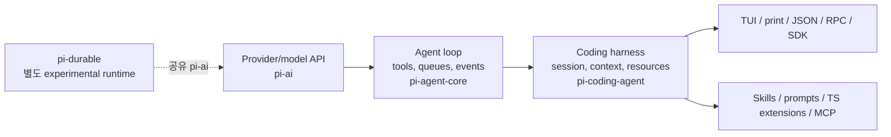

# Pi agent harness에서 ThreadDock이 빌릴 수 있는 것

## 조사 범위와 판정

2026-10-17 기준 Pi 공식 홈페이지, `earendil-works/pi` 공식 저장소와 그 문서·예제만 조사했다.
설치하거나 모델/provider를 호출하지 않았고 Pi의 실제 runtime 동작은 재현하지 않았다.
소스 기준점은 `8efd314fa3d3232ce197d8d7a6a5660530b9d83e`(2026-10-16)이다.
이 checkout은 `v1.3.0-16-g8efd314f`이고 핵심 npm 패키지의 선언 버전도 1.3.0이다
([coding-agent package.json](https://github.com/earendil-works/pi/blob/8efd314fa3d3232ce197d8d7a6a5660530b9d83e/packages/coding-agent/package.json#L2-L4)).

공식 홈페이지의 “Pi 1.0 with Pi Durable”는 2026-10-01 출시 발표를 가리킨다.
1.0은 Codemode, native MCP, virtual model, deferred tool loading, cache warming, 대화 중 system-message 변경을 추가했다
([Pi 1.0 발표](https://earendil.com/posts/pi-1-0/)).
현재 제품·저장소 소유자는 `earendil-works/pi`이며, 이전 `mariozechner`/`badlogic` 글이나 저장소는 역사적 맥락일 뿐 현행 근거로 쓰지 않았다.

결론은 “Pi로 갈아타자”가 아니다. ThreadDock이 지금 빌릴 가치는 아래 네 가지 원리다.

1. **지침, 재사용 prompt, 실행 확장, tool을 서로 다른 층으로 취급한다.** 긴 workflow를 한 거대 catalogue에 넣지 않는다.
2. **관찰 event와 개입 가능한 gate를 구분한다.** 실행 근거는 event/child result에서 수집하되, 근거 수집 자체가 성공 판정이나 안전 경계가 되지는 않는다.
3. **선택된 기능만 점진적으로 노출한다.** Skill 본문과 큰 tool schema를 필요할 때 읽게 해 초기 context를 안정화한다. 이는 cache hit 보장이 아니다.
4. **독립 작업은 별도 context와 구조화 결과로 증명한다.** “reviewer에게 물었다”는 문구가 아니라 child identity, 입력 revision, verdict/result를 연결한다.

후속 적용에서 ThreadDock의 A·B 계약은 기존 Skill/role과 response/handoff evidence 한 줄로 구현했다. [행동 검증](../superpowers/reviews/2026-10-17-plan-completion-contract-verification.md)은 Codex의 실제 child receipt와 OpenCode의 제한 시간 내 incomplete 결과를 구분한다. 이 연구를 근거로 Pi, hook 또는 새 receipt 저장소를 설치하지 않았다.

Pi Durable의 task/storage runtime은 현재 ThreadDock에는 과하다. GitHub가 업무 원본이고 Herdr가 실행 lifecycle을 이미 맡으므로,
새 scheduler·SQLite·재실행 엔진을 들이면 제거한 책임을 되살린다.

## Pi의 층 분리

Pi monorepo의 주 경계는 다음처럼 읽을 수 있다.

- `pi-ai`는 여러 provider/model을 같은 호출 계층으로 묶는다.
- `pi-agent-core`는 stateful agent, tool 실행, event stream, steering/follow-up queue를 제공한다.
  context 변환과 LLM message 변환도 분리한다
  ([agent-core README](https://github.com/earendil-works/pi/blob/8efd314fa3d3232ce197d8d7a6a5660530b9d83e/packages/agent/README.md#L41-L60),
  [steering/follow-up](https://github.com/earendil-works/pi/blob/8efd314fa3d3232ce197d8d7a6a5660530b9d83e/packages/coding-agent/docs/how-pi-works.md#L7-L13)).
- `pi-coding-agent`는 발견되는 context/resource, session tree, compaction, TUI와 SDK/RPC를 결합한다.
  모든 interface가 같은 agent/session mechanism을 쓴다
  ([How Pi Works](https://github.com/earendil-works/pi/blob/8efd314fa3d3232ce197d8d7a6a5660530b9d83e/packages/coding-agent/docs/how-pi-works.md#L25-L45)).
- `pi-durable`은 coding-agent 내부 저장 계층이 아니라 장기 실행 application을 위한 별도 experimental harness다
  ([Pi Durable README](https://github.com/earendil-works/pi/blob/8efd314fa3d3232ce197d8d7a6a5660530b9d83e/packages/durable/README.md#L1-L7)).

ThreadDock 관점의 핵심은 각 층을 제품 하나로 복사하는 것이 아니라 책임 경계를 재사용하는 것이다.
Go/Wails Monitor는 관찰 UI, GitHub는 work truth, Herdr/native agent는 실행이고, Skill은 실행 엔진이 아니다.

## 작은 core와 현재 기본 기능

현재 Pi가 기본 활성화하는 coding tool은 `read`, `bash`, `edit`, `write` 네 개다.
`grep`, `find`, `ls`, `powershell`도 built-in이지만 기본 선택은 아니며, built-in extension의 `codemode`와 `tool_search`도 기본 비활성이다
([CLI tools](https://github.com/earendil-works/pi/blob/8efd314fa3d3232ce197d8d7a6a5660530b9d83e/packages/coding-agent/docs/cli.md#L119-L156)).
현재는 MCP가 built-in이고 Codemode와 결합할 수 있으므로 예전 “No MCP” 설명은 폐기됐다.
반면 subagent, plan mode, permission popup은 여전히 core 기능이 아니라 extension/example 영역이다
([현재 홈페이지](https://pi.dev/)).

이 구성은 “기능을 적게 만들라”보다 “기본 surface를 작게 유지하고 선택적 기능의 활성화 경계를 명확히 하라”는 사례다.
ThreadDock의 여섯 canonical Skill과 역할은 유지하되, 모든 요청에 전 역할·전 규칙을 펼쳐 놓거나 항상 3-Agent 절차를 강제할 이유는 없다.

## 네 가지 확장 수단은 서로 대체재가 아니다

| 수단 | 맡는 일 | 실행력 | ThreadDock 대응 |
|---|---|---:|---|
| context file (`AGENTS.md`, `SYSTEM.md`) | 전역·프로젝트 지침과 기본 prompt | 지침뿐 | global natural routing, 프로젝트 `AGENTS.md` |
| Skill | 이름·설명으로 발견하고 필요할 때 전문 지침/자료를 읽음 | 본문 자체는 지침 | canonical workflow와 specialist Skill |
| prompt template | `/name`을 재사용 message text로 확장 | 실행 없음 | 반복 task packet/request 초안 |
| TypeScript extension | event hook, command, tool, provider, UI, session state | process 내부 코드 | 향후 선택적 evidence adapter/gate |
| tool | 모델이 호출하는 schema+실행 함수 | 실제 side effect 가능 | native delegation/tool call, `gh`, local commands |

Pi는 시작 시 Skill의 이름·설명·경로만 prompt에 싣고 본문은 모델이 필요할 때 읽는다.
관련 Skill을 모델이 놓칠 수도 있어 명시 `/skill:name` 경로도 둔다
([Skills](https://github.com/earendil-works/pi/blob/8efd314fa3d3232ce197d8d7a6a5660530b9d83e/packages/coding-agent/docs/skills.md#L41-L53)).
Prompt template은 agent에 들어가기 전 text를 확장할 뿐이다
([Prompt Templates](https://github.com/earendil-works/pi/blob/8efd314fa3d3232ce197d8d7a6a5660530b9d83e/packages/coding-agent/docs/prompt-templates.md#L27-L49)).
Extension은 같은 OS 권한으로 process 안에서 실행되며 prompt, tool call, file, credential, session history를 볼 수 있다
([Extensions](https://github.com/earendil-works/pi/blob/8efd314fa3d3232ce197d8d7a6a5660530b9d83e/packages/coding-agent/docs/extensions.md#L1-L7)).

ThreadDock의 큰 catalogue에는 이 구분이 유용하다. natural router에는 “언제 어떤 Skill을 읽는가”만 남기고,
긴 acceptance·검증 예시·UI 기준은 선택된 Skill/reference에서 읽으며, 단순 반복 문구만 template로 둔다.
실행을 보장해야 할 항목만 harness-native child/tool/event로 증명한다.

### Context 안정성의 정확한 의미

점진적 Skill 로딩과 deferred tool exposure는 초기 prompt와 tool 선언의 크기·변동을 줄인다.
Pi는 tool 변경을 transcript에 기록하며, provider가 mid-conversation 전환을 표현하지 못하면 전체 checkpoint를 보내 cache prefix가 무효화될 수 있다고 명시한다
([tool exposure](https://github.com/earendil-works/pi/blob/8efd314fa3d3232ce197d8d7a6a5660530b9d83e/packages/coding-agent/docs/extensions.md#L153-L190)).
따라서 ThreadDock에서 기대할 수 있는 것은 “중복 지침 감소, 어떤 정보가 언제 들어왔는지 추적 가능, 초기 context 안정화”다.
provider별 cache hit나 비용 절감을 보장한다고 주장해서는 안 된다.

### Cache warming은 agent wait가 아니다

현재 기본값 `streaming`은 active run 동안만 eligible prompt cache를 유지하고, `idle`을 명시해야 run 사이에도 이어진다.
고정 5분 polling이 아니라 model이 선언한 TTL의 90% 지점(만료 전 최소 10초 여유)에 원 요청을 output 1 token 한도로 다시 보내며, 성공 usage는 session cost에 포함되지만 model context에는 들어가지 않는다
([설정·비용 조건](https://github.com/earendil-works/pi/blob/8efd314fa3d3232ce197d8d7a6a5660530b9d83e/packages/coding-agent/docs/settings.md#L20-L23),
[scheduling source](https://github.com/earendil-works/pi/blob/8efd314fa3d3232ce197d8d7a6a5660530b9d83e/packages/coding-agent/src/core/cache-warmer.ts#L15-L57)).
Model에 해당 cache lifetime이 있고 예상 절감액이 $0.05 이상일 때만 동작하며 일부 Anthropic budget-thinking request는 안전 replay 대상이 아니다. 이는 대기 중 agent를 살려두거나 업무를 재개하는 `agent-wait`가 아니고, 비용을 쓰는 provider cache 최적화이므로 ThreadDock에 자동 도입하지 않는다
([refresh 구현](https://github.com/earendil-works/pi/blob/8efd314fa3d3232ce197d8d7a6a5660530b9d83e/packages/coding-agent/src/core/cache-warmer.ts#L284-L354)).

## Event와 gate: 관찰, 주입, 차단을 구분하기

Pi extension API의 제어점은 강도가 다르다.

| 제어점 | 가능한 일 | 성격 |
|---|---|---|
| `provider_stream_event`, `agent_settled` | provider event 또는 최종 settle 관찰 | notification-only |
| `before_agent_start` | message 추가, prompt section/tool/guideline 조정, 강제 system prompt | 다음 request에 주입·변환 |
| `context`, `context_with_system` | request-local conversation/context 변환 | 일시적 context 변경 |
| `message_end` | 완료 message를 같은 role로 교체 | 결과 변환 |
| `tool_call` | argument 변경 또는 `{block: true}` | 실행 전 gate |
| `tool_result` | content/details/error/result 변경 | 실행 후 변환 |
| `turn_end`, `agent_before_settle` | entry를 제안하고 한 번 더 continue | 제한적 scheduling |
| `agent_settled` | 자동 work가 더 이어지지 않음을 알림 | 완료 관찰, 변경 불가 |

공식 문서는 event마다 반환값 효력이 다르므로 모두를 hook처럼 가정하지 말라고 명시한다.
`tool_call` handler 오류는 fail-safe로 tool을 막지만, 무조건 continue는 loop를 만들 수 있다
([extension event 계약](https://github.com/earendil-works/pi/blob/8efd314fa3d3232ce197d8d7a6a5660530b9d83e/packages/coding-agent/docs/extensions.md#L96-L128),
[오류 처리](https://github.com/earendil-works/pi/blob/8efd314fa3d3232ce197d8d7a6a5660530b9d83e/packages/coding-agent/docs/extensions.md#L261-L267)).

ThreadDock에는 먼저 notification 성격의 증거 수집만 맞는다.
예를 들어 native child 시작/종료, reviewer result, candidate revision을 기존 부모 응답의 한 줄 evidence로 연결할 수 있다.
이 observer가 “리뷰 내용이 타당하다”, “UI가 아름답다”, “계획이 ready다”를 판정해서는 안 된다.
반복 누락이 충분히 관찰된 뒤에만 좁은 pre-completion 경고/gate를 검토한다.

## Session, lineage와 외부 통합

Pi coding-agent session은 JSONL tree다. 각 entry가 `id`/`parentId`를 갖고, fork/clone session header는 `parentSession`을 기록한다
([Session Format](https://github.com/earendil-works/pi/blob/8efd314fa3d3232ce197d8d7a6a5660530b9d83e/packages/coding-agent/docs/session-format.md#L1-L14),
[header lineage](https://github.com/earendil-works/pi/blob/8efd314fa3d3232ce197d8d7a6a5660530b9d83e/packages/coding-agent/docs/session-format.md#L64-L80)).
Compaction은 과거 raw entry를 삭제하지 않고 이후 model context에서 summary/checkpoint로 대체한다.
`context_edit`도 raw history를 바꾸지 않고 이후 context projection만 바꾼다
([context projection](https://github.com/earendil-works/pi/blob/8efd314fa3d3232ce197d8d7a6a5660530b9d83e/packages/coding-agent/docs/session-format.md#L224-L248)).

통합 surface는 interactive, 일회성 print, 일회성 JSON event stream, 장기 bidirectional RPC, in-process TypeScript SDK다.
RPC의 prompt 응답은 접수 성공일 뿐 완료가 아니며 `agent_settled`까지 event를 읽어야 한다
([CLI Integration](https://github.com/earendil-works/pi/blob/8efd314fa3d3232ce197d8d7a6a5660530b9d83e/packages/coding-agent/docs/cli-integration.md#L9-L18),
[RPC completion](https://github.com/earendil-works/pi/blob/8efd314fa3d3232ce197d8d7a6a5660530b9d83e/packages/coding-agent/docs/cli-integration.md#L54-L76)).

여기서 ThreadDock이 빌릴 것은 새 session DB가 아니라 **lineage receipt**다.
부모 요청/session, child role/session, plan 또는 code revision, 최종 result/verdict를 연결하면 “명시적 reviewer가 실제 실행됐는가”를 관찰할 수 있다.
현재 Herdr locator와 harness native event/export가 이미 가진 ID를 링크하면 충분하며, 별도 SQLite 원본은 필요 없다.

## 모델·capability routing과 안전 경계

Pi는 model catalog에 provider, model ID, 입력 capability, context limit 등을 두고 catalog를 갱신할 수 있다.
선택한 model과 thinking level은 session에 기록된다
([Choose a Model](https://github.com/earendil-works/pi/blob/8efd314fa3d3232ce197d8d7a6a5660530b9d83e/packages/coding-agent/docs/models.md#L15-L35)).
Virtual model extension은 request마다 물리 model을 고를 수 있고, 선택 pair와 실제 dispatch pair를 별도로 기록한다
([Virtual Models](https://github.com/earendil-works/pi/blob/8efd314fa3d3232ce197d8d7a6a5660530b9d83e/packages/coding-agent/docs/virtual-models.md#L1-L29)).

그러나 이것은 capability metadata와 routing mechanism이지 품질 보증이 아니다.
ThreadDock의 실제 시험에서도 Codex는 같은 PNG의 항목을 읽었지만 OpenCode의 현재 `big-pickle` 경로는 image capability가 false였고 읽지 못했다.
자동 review는 둘 다 누락했고, 명시적 reviewer 요청에서는 child 실행이 확인됐다
([현재 아키텍처와 행동 근거](../architecture/agent-workflow.md#2026-10-16-행동-시험이-보여준-간극)).
따라서 모델 자동 승격이나 provider 교체 대신, 선택된 runtime capability를 기록하고 미지원 검증은 미검증으로 남기는 현 정책을 유지해야 한다.

Pi도 built-in permission system이나 매 tool-call 승인 popup을 안전 경계로 제공하지 않는다.
Tool과 extension은 Pi process의 OS 권한을 쓰며 project trust도 tool 접근을 제한하지 않는다
([Security](https://github.com/earendil-works/pi/blob/8efd314fa3d3232ce197d8d7a6a5660530b9d83e/packages/coding-agent/docs/security.md#L1-L21),
[project trust 한계](https://github.com/earendil-works/pi/blob/8efd314fa3d3232ce197d8d7a6a5660530b9d83e/packages/coding-agent/docs/security.md#L27-L57)).
ThreadDock도 role prompt의 read-only 요구를 OS sandbox 보장으로 표현하지 않고, 기존 sandbox·권한·승인 정책을 유지해야 한다.

## Subagent 독립성과 증거

Pi core에는 built-in subagent가 없지만 공식 example extension은 child마다 별도 `pi` process를 JSON mode와 `--no-session`으로 실행해 context를 격리한다.
agent별 system prompt/tool/model을 넘기고, model을 생략하면 부모의 active model/thinking을 상속한다
([subagent example](https://github.com/earendil-works/pi/blob/8efd314fa3d3232ce197d8d7a6a5660530b9d83e/packages/coding-agent/examples/extensions/subagent/README.md#L1-L13),
[child invocation](https://github.com/earendil-works/pi/blob/8efd314fa3d3232ce197d8d7a6a5660530b9d83e/packages/coding-agent/examples/extensions/subagent/index.ts#L270-L348)).
Parent는 child JSON event에서 message, tool result, model, usage, stop reason과 오류를 모아 structured tool details/result로 돌려받는다
([result capture](https://github.com/earendil-works/pi/blob/8efd314fa3d3232ce197d8d7a6a5660530b9d83e/packages/coding-agent/examples/extensions/subagent/index.ts#L349-L423)).

이는 ThreadDock의 `root → Feature Leader → bounded leaf`, 독립 worktree, fresh reviewer와 잘 맞는다.
다만 Pi example의 별도 process만으로 “독립 reviewer”가 성립하는 것은 아니다.
검토 대상 revision 고정, 구현자와 다른 context/역할, 편집 금지 책임, verdict와 finding 반환이 함께 있어야 한다.
또한 child 최종 text는 evidence이지 진실 판정이 아니므로 부모가 acceptance와 실제 command 결과를 대조해야 한다.

## Pi Durable은 무엇이며 왜 지금은 보류하는가

Pi Durable은 model turn/tool call/custom state를 보이기 전에 storage에 commit하고, crash 후 unfinished task를 checkpoint에서 재개하는 experimental harness다.
Harness, immutable conversation entry, atomic commit, document, durable task, submission을 핵심 개념으로 둔다
([개념](https://github.com/earendil-works/pi/blob/8efd314fa3d3232ce197d8d7a6a5660530b9d83e/packages/durable/README.md#L71-L101)).
Memory, JSONL, SQLite backend와 request ID 중복 억제, crash resume를 제공한다
([persist/resume](https://github.com/earendil-works/pi/blob/8efd314fa3d3232ce197d8d7a6a5660530b9d83e/packages/durable/README.md#L103-L126)).

장기 서버형 agent, 여러 client가 동시에 조종하는 conversation, tool side effect의 crash recovery가 필요하면 검토할 가치가 있다.
현재 ThreadDock은 이를 요구하지 않는다. GitHub/Herdr/native harness가 이미 업무·실행·child lifecycle을 나눠 맡고,
Monitor는 observer여야 한다. Pi Durable 채택은 새 JS runtime, scheduler, storage, replay/idempotency 정책과 운영 책임을 추가한다.
따라서 지금은 **개념만 참고하고 채택하지 않는다**.

## 현재 ThreadDock과의 대조

| 관심사 | ThreadDock 현재 | Pi에서 확인한 primitive | 판단 |
|---|---|---|---|
| 자연어 진입 | 짧은 global router → Coordinator 또는 FL, 작은 일은 경량 처리 | context file + progressive Skill discovery | 현재 방향 유지, catalogue 노출만 더 줄일 수 있음 |
| 계획 소유 | FL 단일 owner, 중요 계획만 adversarial review, 미결 시 neutral 1회 | plan mode는 core가 아닌 extension | Pi plan mode 도입 불필요 |
| 구현/검토 | bounded leaf + focused check + fresh review | 별도 child process + JSON event/result | receipt 구조만 차용 |
| 업무·실행 원본 | GitHub work truth, Herdr top-level session | Pi JSONL session tree | 원본 교체 금지; ID 연결만 참고 |
| 제품 관찰 | Go/Wails Monitor, Go가 GitHub·Herdr를 결합 | JSON/RPC/SDK event surface | 특정 harness adapter는 조건부 |
| 안전 | 기존 permission/sandbox/승인 상속 | core sandbox/permission 없음 | 자동 권한·모델 변경 금지 유지 |
| 완료 표현 | A: draft/reviewed/ready 분리, B: 기존 response/handoff 한 줄 evidence 구현 | settled event와 structured child result | A·B와 직접 정합 |

현재 [Agent workflow 문서](../architecture/agent-workflow.md)의 핵심 흐름은 Pi보다 더 구체적이다.
짧은 routing → Coordinator brief → FL 계획 소유 → 중요한 경우 독립 반대 검토 → 조건부 neutral 판정 → 구현/검증 → fresh review다.
실제 자연어 fixture는 feature 선택은 했지만 Codex/OpenCode 모두 자동 독립 review를 생략했다.
이는 instruction이 desired behavior임을 보일 뿐 mechanical execution guarantee가 아님을 확인한 사례다.

## 권고

### 지금 채택

1. **A·B를 그대로 우선한다.** FL 결과를 `unreviewed draft`, `reviewed`, `implementation-ready`로 분리하고,
   기존 응답에 `revision + reviewer child/result + verdict + unresolved` 한 줄을 남긴다.
2. **progressive disclosure를 정리 원리로 쓴다.** global/project AGENTS에는 routing·불변 경계만,
   선택된 Skill에는 lifecycle, reference에는 상세 기준·예시를 둔다. 같은 규칙을 여러 층에 복제하지 않는다.
3. **receipt는 관찰 근거로만 쓴다.** child/event가 실제 review 실행을 증명할 수는 있지만 계획 품질·UI 미감·검증 성공을 대신 판단하지 않는다.

### 반복 비용이 확인될 때 조건부 실험

1. Codex/OpenCode 각각에서 이용 가능한 native event/export를 읽어
   `{parent, child, role, inputRevision, resultRef, verdict}`만 추출하는 작은 read-only helper를 한 harness부터 시험한다.
2. 충분한 입력의 중요한 계획에서 review 누락이 계속 재현될 때만 pre-completion 경고를 검토한다.
   자동 spawn, stop/continue loop, 일반 질문·작은 수정의 review 강제는 제외한다.
3. tool catalogue가 실제 context 병목이면 deferred discovery 또는 tool-search와 유사한 adapter를 별도 실험한다.
   provider cache hit 개선을 acceptance로 두지 않고 prompt/tool declaration diff와 token 관찰만 측정한다.

### 채택하지 않음

- Pi migration 또는 새 Node agent server
- Pi Durable/SQLite 기반 업무·실행 원본
- 모든 작업의 고정 다중-agent ceremony
- model/provider/effort 자동 routing 또는 vision 모델 자동 교체
- permission popup을 sandbox로 간주하거나 기존 승인을 우회하는 extension
- Monitor가 작업을 실행·승인·완료 판정하는 새 엔진

## 최소 다음 단계

현재 진행 중인 A(FL 완료 상태 명료화)와 B(기존 응답의 evidence 한 줄)를 마친 뒤,
이름 없는 중요 계획 fixture 하나에서 아래 네 항목만 확인한다.

1. plan revision이 고정됐는가.
2. 실제 native reviewer child가 별도 identity/context로 실행됐는가.
3. parent가 reviewer result와 finding 처리 여부를 연결했는가.
4. `reviewed`와 `implementation-ready`를 독립적으로 판정했는가.

여기서 event를 사람이 다시 모으는 비용이나 누락이 반복될 때만 read-only receipt helper를 제안한다.
새 database, scheduler, execution engine 없이 기존 source of truth와 native harness trace를 잇는 것이 경계다.

## 한계와 미검증

- Pi를 설치·실행하거나 provider/model/MCP를 호출하지 않았다. 공식 문서와 고정 source의 정적 조사다.
- 1.3.0 package 선언 이후의 main commit 16개를 포함한 snapshot이므로 설치된 stable binary와 세부 동작이 다를 수 있다.
- extension example은 지원되는 primitive의 근거이지 production 보안·신뢰성 보증이 아니다.
- ThreadDock의 Codex/OpenCode 행동 근거는 각 소수 fixture이며 일반 성공률이나 모델 우열을 증명하지 않는다.
- native event/export의 양 harness 공통 schema, OpenCode vision 지원 모델 선택, helper 구현 방식은 후속 실험 사항이다.
- 이 문서는 연구·의사결정 자료이며 AGENTS, Skill, runtime 설정, 제품 코드, Herdr/GitHub 상태를 변경하지 않는다.
